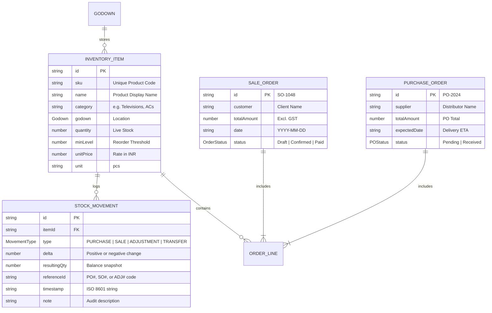

<div align="center">

# Gada Electronics — Enterprise Inventory Management System

<p align="center">
  <strong>A high-performance, real-time inventory, multi-godown warehouse ledger, sales invoicing, and procurement platform built for consumer electronics enterprises.</strong>
</p>

<p align="center">
  <a href="#features">Features</a> •
  <a href="#architecture">Architecture</a> •
  <a href="#getting-started">Quickstart</a> •
  <a href="#tech-stack">Tech Stack</a> •
  <a href="#data-model">Data Model</a> •
  <a href="#design-system">Design System</a>
</p>

<p align="center">
  
  
  
  
  
  
</p>

</div>

---

## 📌 Executive Summary

Modern retail and wholesale enterprises require tight synchronicity between retail showroom floors, regional warehouses, and peripheral transit depots. Traditional ERPs are often sluggish, complex, and poorly designed for fast counter-side operations.

**Gada Electronics IMS** is an opinionated, modern SaaS-grade ERP designed from the ground up to solve:
- **Disjointed Multi-Warehouse Tracking**: Real-time stock parity between retail showrooms and peripheral godowns.
- **Stock-Out Blindspots**: Proactive automated alerts triggering intelligent supplier replenishment orders.
- **Overselling Prevention**: Strict optimistic validation ensuring customer invoice lines never exceed physical warehouse stock.
- **Audit Deficits**: A cryptographic-like, chronological ledger logging all inbound, outbound, transfer, and adjustment operations.

---

## ✨ Core Features

| Feature Domain | Capabilities |
| :--- | :--- |
| **Warehouse & Godowns** | Multi-facility tracking across **Showroom Floor**, **Goregaon Godown**, and **Andheri Depot** with inter-godown transfers (`TRANSFER`). |
| **Audit Ledger** | Immutable historical logging for every physical movement (`PURCHASE`, `SALE`, `ADJUSTMENT`, `TRANSFER`) with custom personnel tags (*Nattu Kaka*, *Bagha*). |
| **Replenishment Engine** | Automated classification of `In stock`, `Low stock`, and `Out of stock` items with one-click pre-filled Purchase Orders. |
| **Sales & Billing** | Instant customer sales order generation, stock reservation, and printable GST tax invoices (18% GST calculation). |
| **Distributor Procurement** | B2B purchase tracking, delivery scheduling, and single-click Goods Receipt Note (`GRN`) stock intake. |
| **Analytics & BI** | Live interactive **Recharts** visualizations for inventory category valuations, client revenue distributions, and vendor spend analysis with CSV export. |

---

## 🏗️ Clean Architecture

The project adheres to strict **Clean Architecture** and **Domain-Driven Design (DDD)** standards, maintaining zero coupling between UI primitives, business rules, and state management.

```
inoventry/
├── app/                              # Next.js App Router root
│   ├── globals.css                   # Global styles & design system tokens
│   ├── layout.tsx                    # Top-level viewport, fonts & analytics
│   └── page.tsx                      # View composition root
├── types/                            # Domain entity definitions & interfaces
│   └── inventory.ts                  # InventoryItem, Movement, OrderLine, Godown
├── data/                             # Initial fixtures & demo seed data
│   └── seed.ts                       # Gada Electronics catalog & seed transactions
├── hooks/                            # Business logic & reactive state
│   └── use-inventory.tsx             # Context provider, persistence & dispatchers
├── lib/                              # Core utilities & domain logic
│   ├── constants.ts                  # Godown arrays, navigation items & button classes
│   ├── format.ts                     # Currency (₹ INR), time and date formatters
│   └── utils.ts                      # Tailwind styling merge utility
├── components/
│   ├── layout/                       # Structural app scaffolding
│   │   ├── app-shell.tsx             # Main responsive viewport orchestrator
│   │   ├── header.tsx                # Sticky top bar, notifications & global actions
│   │   └── sidebar.tsx               # Navigation drawer & profile management
│   ├── shared/                       # Cross-cutting composite dialogs
│   │   ├── detail-drawer.tsx         # Slide-in stock ledger & invoice drawer
│   │   └── order-modal.tsx           # Order submission dialogs
│   └── ui/                           # Atomic, reusable UI primitives
│       ├── button.tsx                # Shadcn button variants
│       ├── empty-state.tsx           # Zero-state placeholder with clear filters
│       ├── filter-bar.tsx            # Horizontal filter & search bar
│       ├── metric.tsx                # KPI cards with trend indicators
│       ├── overlay.tsx               # Modal dialog backdrop & shell
│       ├── page-intro.tsx            # View header with actions
│       ├── pills.tsx                 # Segmented status & warehouse switchers
│       ├── status-badge.tsx          # Micro-badge with semantic status dot
│       └── stock-level.tsx           # Visual ratio progress indicator
└── features/                         # Modular business views
    ├── dashboard/dashboard-view.tsx  # Executive overview & alert feeds
    ├── purchases/purchase-view.tsx   # Supplier procurement & intake orders
    ├── reports/reports-view.tsx      # Fiscal metrics, charts & CSV export
    ├── sales/sales-view.tsx          # Client invoices & billing tracking
    └── stock/stock-view.tsx          # Live inventory search & warehouse filters
```

---

## 🚀 Getting Started

### Prerequisites

- **Node.js**: `v18.18.0` or higher (Node 20+ recommended)
- **Package Manager**: [`pnpm`](https://pnpm.io/) `v9.0.0+` (or `npm` / `yarn`)

### Installation

1. **Clone the repository:**
   ```bash
   git clone git@github-personal:bitwizard25/inventory_management_system.git
   cd inventory_management_system
   ```

2. **Install project dependencies:**
   ```bash
   pnpm install
   ```

3. **Start the local development server:**
   ```bash
   pnpm dev
   ```

4. **Open in browser:**
   Navigate to [http://localhost:3000](http://localhost:3000) to view the live workspace.

### Production Build & Type Verification

Verify zero TypeScript compilation errors and build the production bundle with Next.js Turbopack:

```bash
# Run strict TypeScript verification
pnpm tsc --noEmit

# Compile production bundle
pnpm build

# Launch production server
pnpm start
```

---

## 📐 Data Model & Business Rules



### Business Validation Rules
- **Non-Negative Stock**: Stock balances cannot drop below 0. Sales requests exceeding available inventory are blocked with toast diagnostics.
- **Stock Deductions**: Confirmed sales immediately deduct units from the source warehouse and generate a negative ledger movement (`SALE`).
- **Stock Replenishment**: Marking a purchase order as `Received` increases inventory balances and logs an intake movement (`PURCHASE`).
- **Warehouse Transfers**: Stock transfers require distinct source and destination godowns and log dual entries (`TRANSFER: out` and `TRANSFER: in`).

---

## 🎨 Design System & Aesthetics

Crafted according to the **Linear / Mercury / Vercel** product design language:

- **Palette**:
  - Background canvas: `#F8F9FA`
  - Cards & Containers: `#FFFFFF` with crisp 1px borders (`#E5E7EB`)
  - Accent / Primary Action: Obsidian Black (`#09090B`, active `#27272A`)
  - Status Indicators: 6px semantic dots:
    - 🟢 `#10B981` (In stock / Paid / Received)
    - 🟡 `#F59E0B` (Low stock / Pending / Draft)
    - 🔴 `#EF4444` (Out of stock)
- **Typography & Scale**:
  - System font stack prioritizing native hardware rendering.
  - Tabular numerics (`tabular-nums`) applied to all currencies, SKUs, and counts to prevent visual layout shifts.
  - Strict whitespace controls (`whitespace-nowrap`) on action triggers, navigation pills, and table headers.
- **Responsive Layout**:
  - Calibrated tables with horizontal scroll wrappers preventing clipped unit rates or actions across 1280px–1440px desktop screens.

---

## 📦 Tech Stack

- **Framework**: [Next.js 16](https://nextjs.org/) (App Router, Server & Client Components)
- **UI Runtime**: [React 19](https://react.dev/)
- **Type Safety**: [TypeScript 5.7](https://www.typescriptlang.org/)
- **Styling**: [Tailwind CSS v4](https://tailwindcss.com/)
- **Component Primitives**: [@base-ui/react](https://base-ui.com/), [Shadcn UI](https://ui.shadcn.com/)
- **Iconography**: [Lucide React](https://lucide.dev/)
- **Charts & Visualization**: [Recharts](https://recharts.org/)
- **Toast Notifications**: [Sonner](https://sonner.emilkowal.ski/)
- **Packaging**: [pnpm](https://pnpm.io/)

---

## 📄 License

Distributed under the **MIT License**. See `LICENSE` for more information.

<div align="center">
  <sub>Built with ❤️ for Gada Electronics, Goregaon East, Mumbai.</sub>
</div>
